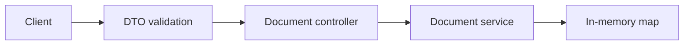

# NestJS Document API

[](https://github.com/amenibensaada/nestjs-document-api/actions/workflows/ci.yml)

A small, runnable TypeScript API for storing document text and retrieving document metadata. Created as a portfolio demonstration in November 2026: input validation, predictable HTTP errors, automated API tests and a container delivery workflow.

Built by [Ameni Ben Saada](https://github.com/amenibensaada) · [Software engineering portfolio](https://amenibensaadaportfolio.netlify.app/?utm_source=github&utm_medium=profile&utm_campaign=personal_brand)

## What it demonstrates

- NestJS controllers and an injectable service, with a small explicit API contract.
- Trimmed, bounded input; unknown properties and invalid UUIDs are rejected.
- Metadata-only lists with a validated limit, and content returned only by the detail route.
- HTTP contract tests covering the document lifecycle, validation, missing records and health checks.
- A multi-stage Docker image running as the non-root Node user, plus a health check.
- GitHub Actions runs the tests, builds the image and exercises its HTTP endpoints.



## Run locally

Requires Node.js 22 or newer and npm. No account, API key or database is required.

```sh
npm ci
npm test
npm start
```

The API listens on `http://localhost:3000/api`. To select another port, set `PORT` in the shell (`PORT=3001 npm start` on macOS/Linux). `.env.example` documents the variable; the app does not load `.env` automatically.

```sh
curl http://localhost:3000/api/health
curl -X POST http://localhost:3000/api/documents \
  -H 'Content-Type: application/json' \
  -d '{"title":"Release notes","content":"A reproducible delivery example."}'
curl 'http://localhost:3000/api/documents?limit=10'
```

Use the returned `id` with `GET /api/documents/:id` or `DELETE /api/documents/:id`.

| Endpoint | Behavior |
| --- | --- |
| `GET /api/health` | Reports the app and its memory storage |
| `POST /api/documents` | Creates a document; returns 201 |
| `GET /api/documents?limit=10` | Lists newest metadata; limit 1–50 |
| `GET /api/documents/:id` | Returns one document, or 404 |
| `DELETE /api/documents/:id` | Deletes one document; returns 204 or 404 |

Titles are 1–120 characters and content is 1–20,000 characters after trimming. Validation errors return 400. Unknown properties are rejected rather than silently stored.

## Container

```sh
docker build -t nestjs-document-api .
docker run --rm -p 127.0.0.1:3000:3000 nestjs-document-api
```

The container uses port 3000 internally. The image is checked on the Linux CI runner; the local verification covers TypeScript compilation and HTTP tests.

## Deliberate limits

This is an original educational API example, separate from employer projects. Storage is process-local and is cleared on restart; data is not shared between instances. There is no authentication, file upload, database, AI extraction or hosted production service. Use synthetic text when trying it. A production document system would need durable storage, access control and an operational deployment plan.

The older academic projects on this profile illustrate earlier work. This repository provides a compact current example of API quality and delivery practices; it is not presented as a client engagement.

## License

MIT — see [LICENSE](LICENSE).
